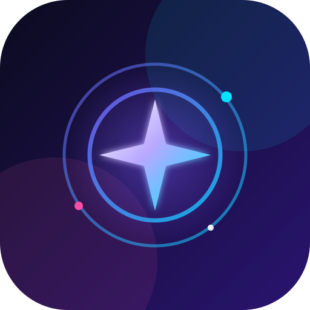
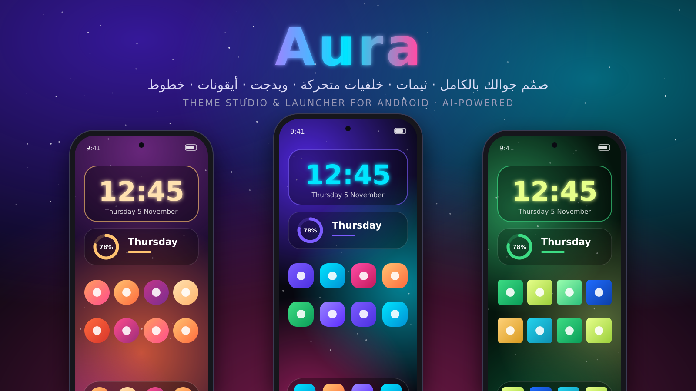

<div align="center">



# Aura — Theme Studio & Launcher

**صمّم جوالك بالكامل: ثيمات، خلفيات متحركة، ويدجت، أيقونات، خطوط، وإشعارات — بمساعدة الذكاء الاصطناعي.**



</div>

---

## المميزات

| | |
|---|---|
| 🎨 **ثيمات كاملة** | ٦ ثيمات جاهزة + إنشاء وتعديل ونسخ ومشاركة ثيماتك |
| 🌌 **خلفيات** | شفق، نجوم، أمواج، مطر، جزيئات، تدرّجات — بالإضافة لصورة / GIF / فيديو |
| ⏰ **جدولة بالوقت** | خلفية للنهار وأخرى لليل (أو أي فترات تحددها) |
| 🧩 **ويدجت** | ساعات وحلقات بطارية وبطاقات تاريخ، بخطوط وحركات (نبض، طفو، توهج…) + **محرر ويدجت يدوي** |
| 🔷 **أيقونات** | أشكال (دائرة، مربع، قطرة، سداسي…)، تلوين، حزم أيقونات (Nova/ADW)، وصورة مخصصة لأي تطبيق |
| 🔤 **خطوط** | استورد أي خط TTF / OTF ويتطبّق على كل شي |
| 🔔 **إشعارات** | بطاقات إشعارات بتصميمك (زجاجي، صلب، إطار، بسيط) |
| 🤖 **الذكاء الاصطناعي** | التطبيق يعطيك **برومبت** → تعطيه لأي AI (ChatGPT / Claude / Gemini) → تلصق النتيجة أو تستورد الملف → يشتغل الثيم فوراً |
| 🏠 **لانشر** | شاشة رئيسية بالويدجت المتحركة + درج تطبيقات بأيقوناتك |

## التحميل

كل مرة يتم الرفع على GitHub يُبنى الـ APK تلقائياً:

1. افتح تبويب **Actions** ← آخر تشغيل **Build APK** ← حمّل **Aura-Theme-Studio** (أو من **Releases**).
2. ثبّته على جوالك (فعّل «التثبيت من مصادر غير معروفة»).

## الاستخدام السريع

1. افتح Aura ← **الثيمات** ← اضغط **اجعله اللانشر** لتفعيل الشاشة الرئيسية.
2. **الخلفية** ← اختر نوع الخلفية ← **تفعيل كخلفية حيّة** (يفتح معاينة النظام).
3. **الذكاء** ← اكتب وصف ثيمك ← **نسخ البرومبت** ← الصقه عند أي AI ← انسخ الرد ← **لصق** ← **تشغيل**.

### صيغة ملف الثيم (JSON)

التطبيق يقبل رد الـ AI حتى لو فيه شرح حوله، ويلقط الـ JSON تلقائياً. مثال مبسّط:

```json
{
  "name": "Cyber Rose",
  "palette": { "primary": "#FF4DA6", "secondary": "#00E5FF", "background": "#0B0B14" },
  "wallpaper": { "type": "aurora", "colors": ["#07070F", "#FF2E93", "#5B2BFF"], "speed": 0.8 },
  "icons": { "shape": "circle" },
  "notifications": { "enabled": true, "style": "glass", "accent": "#FF4DA6" },
  "widgets": [
    { "name": "Clock", "w": 300, "h": 150, "x": 0.5, "y": 0.2, "background": "#66120A2E", "corner": 34,
      "elements": [
        { "kind": "time", "x": 0.5, "y": 0.42, "size": 66, "color": "#00E5FF", "bold": true, "anim": "glow" },
        { "kind": "date", "x": 0.5, "y": 0.82, "size": 16, "color": "#CCFFFFFF" }
      ] }
  ]
}
```

## ملاحظات مهمة (حدود أندرويد)

- **ما فيه root**: التطبيق ما يغيّر ثيم نظام MIUI/HyperOS نفسه (الإعدادات وشريط الحالة). التغيير يشمل: الخلفية، الشاشة الرئيسية (لانشر Aura)، الويدجت، الأيقونات، الخطوط داخل Aura، والإشعارات المعاد عرضها.
- **الإشعارات المصمّمة**: تحتاج صلاحية «الوصول إلى الإشعارات». Aura يعيد نشر إشعارات التطبيقات بتصميمك ويخفي الأصلي (تقدر توقف الإخفاء).
- **Redmi / Xiaomi**: فعّل «التشغيل التلقائي» وأوقف «توفير البطارية» لـ Aura عشان الويدجت والخلفية الحيّة ما تتوقف.
- **الأيقونات خارج Aura**: أيقونات النظام تتغير فقط داخل لانشر Aura.

## البناء من المصدر

```bash
./gradlew assembleRelease
# الناتج: app/build/outputs/apk/release/app-release.apk
```

المتطلبات: JDK 17 و Android SDK 34. أو افتح المجلد في Android Studio (Koala أو أحدث).

## التقنية

Kotlin · Jetpack Compose · Canvas rendering · WallpaperService · AppWidget · NotificationListenerService · kotlinx.serialization
